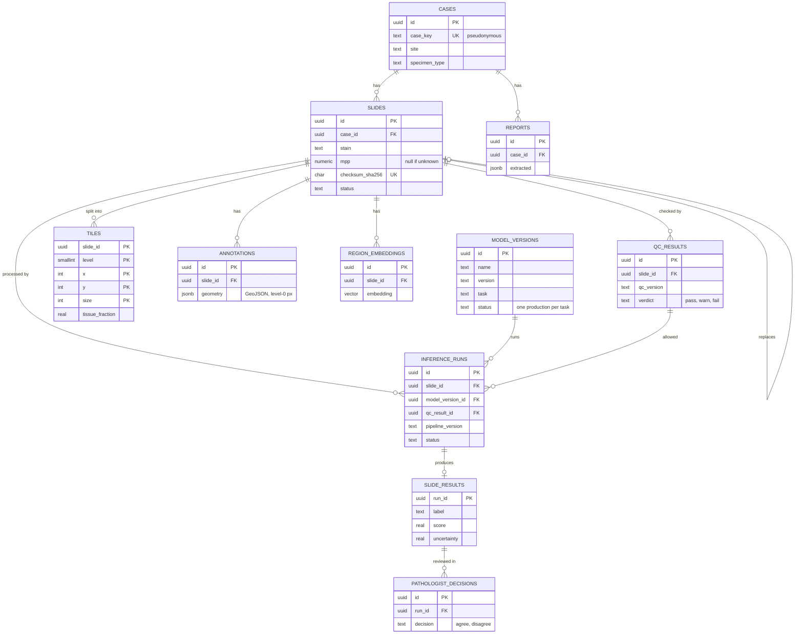

# Contracts

Everything in this folder is shared by every component of the platform (.NET API, .NET workers, Python services, Blazor app). It changes **only through a reviewed pull request**, and `uv run tools/check_contracts.py` must pass.

| File | What it defines |
|---|---|
| `schema.sql` | PostgreSQL tables, keys, constraints and indexes (reference for EF Core migrations) |
| `openapi/platform-api.yaml` | The HTTP API (OpenAPI 3.1) |
| `events/*.schema.json` | One JSON Schema per event; shared definitions in `common.schema.json` |
| `sample-data/events/*.json` | One valid example per event, used in tests |
| `tests/constraints.sql` | Behaviour checks for the database constraints |

## Data model

## Conventions

**IDs.** Every entity ID is a UUIDv7 (time-ordered), generated by the application (`Guid.CreateVersion7()` in .NET 9+). Exceptions: `tiles` (natural key `slide_id, level, x, y, size`) and `audit_log` (bigint identity, append-only).

**No patient identifiers.** Cases are identified by a pseudonymous `case_key`. Names, dates of birth and hospital numbers never enter the platform, its logs or its events.

**Naming.** Database: `snake_case`. JSON (API and events): `camelCase`. Enum values: `snake_case` strings, identical in all three places.

**Coordinates.** All coordinates are **level-0 pixel coordinates** of the slide: `x` to the right, `y` down, origin at the top-left. Physical size = pixels × `mpp`. Tiles are addressed by `(slideId, level, x, y, size)`; Deep Zoom tile URLs use Deep Zoom's own level/column/row numbering and are converted by the tile API.

**Geometry.** Annotations and regions are GeoJSON geometries in level-0 pixel coordinates (not longitude/latitude).

**Lineage.** Every result records the model version, pipeline version and QC result that produced it.

**Times.** UTC, ISO 8601 (`2026-10-14T09:00:05Z`); `timestamptz` in the database.

## Object storage layout

| Prefix | Contents | Written by |
|---|---|---|
| `raw/{slideId}` | The uploaded slide file, de-identified | Ingestion API |
| `qc/{slideId}/tissue-mask.png` | Tissue mask at thumbnail resolution | QC worker |
| `tiles/{slideId}/` | Deep Zoom pyramid (`slide.dzi`, `slide_files/{level}/{col}_{row}.jpeg`) | Tiling worker |
| `scores/{runId}.parquet` | Tile scores for one inference run | Inference worker |
| `overlays/{runId}/{layer}.png` | Rendered overlays | Aggregator |
| `models/{modelVersionId}/model.onnx` | Registered model | Model registry |
| `reports/{reportId}.txt` | Raw report text | Report API |

## Tile scores (Parquet)

One file per inference run at `scores/{runId}.parquet`:

| Column | Type | Meaning |
|---|---|---|
| `x`, `y` | int32 | Tile position, level-0 pixels |
| `size` | int32 | Tile size, level-0 pixels |
| `probability` | float32 | Model probability for the positive class (0–1) |
| `uncertainty` | float32 | Uncertainty (e.g. ensemble standard deviation) |
| `tissue_fraction` | float32 | Share of the tile covered by tissue |

## Events

Every event has the envelope fields `eventId`, `occurredAt`, `schemaVersion` and `correlationId` (usually the slideId). Consumers ignore an `eventId` they have already processed. Unknown fields are not allowed (`unevaluatedProperties: false`).

| Event | Published by | Consumed by |
|---|---|---|
| `SlideIngested` | Ingestion API | QC worker |
| `SlideQcCompleted` | QC worker | Tiling worker (if pass or warn), dashboard |
| `SlideTiled` | Tiling worker | Inference worker, embedding worker |
| `InferenceCompleted` | Inference worker | Aggregator, overlay builder |
| `SlideResultReady` | Aggregator | API (SignalR), triage service, indexer |
| `ReportReceived` | Report API | NLP service |
| `ReportStructured` | NLP service | FHIR mapper, label store |

## Changing a contract

- **Non-breaking** (adding an optional field, a new endpoint, a new event): normal PR.
- **Breaking** (removing or renaming a field, changing a type, removing an enum value): bump `schemaVersion` for events or the API version, support old and new for a transition period, and record the change in an ADR.
