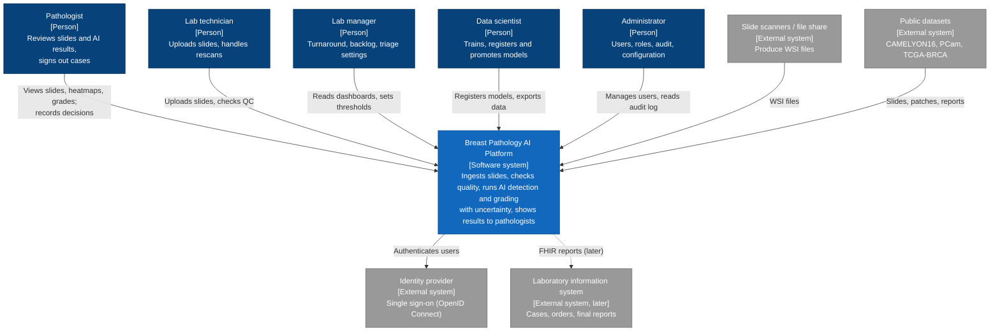
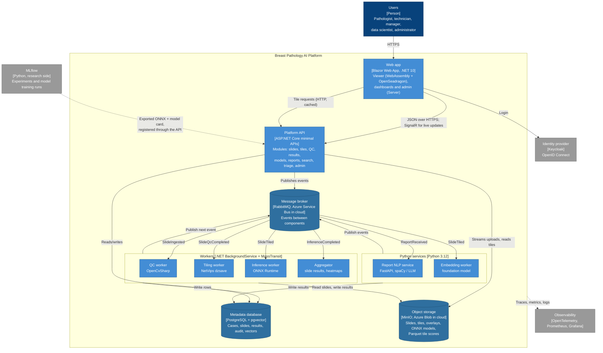
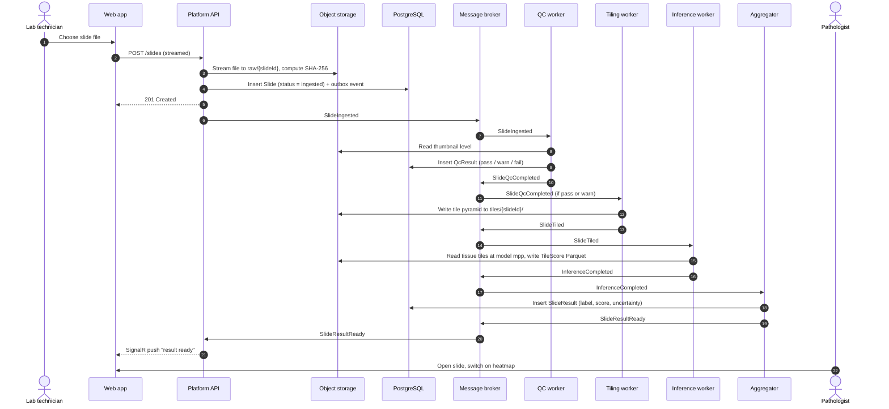

# Architecture: Breast Pathology AI Platform

*Lesson L1.2 deliverable. Copy to `docs/architecture/README.md` and make it your own.*
*Version 0.1 · 2026-10 · Sources: [vision](../product/vision.md), [requirements](../product/requirements.md), [ADRs](../adr/)*

## Summary

The platform is a **modular monolith API with an event-driven processing pipeline**. One ASP.NET Core API handles every request from the Blazor web app. Long-running work (quality control, tiling, inference, report extraction, embeddings) is published as events to a message broker and done by independent workers in .NET and Python. All components share three stores: PostgreSQL (metadata and vectors), object storage (slides, tiles, overlays, models) and Parquet files (tile-level results).

## Quality attributes that drive the architecture

| Quality attribute | Requirement | Architectural answer |
|---|---|---|
| Large files | NFR-02: 2 GB upload with flat memory | Stream uploads straight to object storage; never hold a slide in memory |
| Throughput | NFR-04: scale with workers | Long work runs in workers that read from queues; add workers to go faster |
| Reliability | NFR-09: no slide silently lost | Durable queues, retries, dead-letter queues, idempotent consumers |
| Responsiveness | NFR-01: tiles p95 < 200 ms | Tiles served over HTTP straight from pre-built pyramids, bypassing Blazor |
| Privacy | NFR-05: no identifiers | De-identification at ingestion, the single entry point |
| Portability | NFR-12, US-29: local and cloud | Storage and messaging behind interfaces, chosen by configuration |
| Two languages | Python research, .NET platform | Models cross the boundary as ONNX files; Python services talk through events and HTTP |

## C4 level 1: System context

## C4 level 2: Containers

"Container" in C4 means **a separately running or deployable unit** (an app, a service, a database), not necessarily a Docker container, although here most of them will also run in Docker.

## Main flow: from upload to result

Each arrow into a worker is **asynchronous**: the technician gets "201 Created" after step 5 and doesn't wait for QC, tiling or inference. If a worker crashes, its message stays in the queue and is retried.

## Code structure (preview of L2.1)

| Container | Project / package |
|---|---|
| Web app | `src/Platform.Web` |
| Platform API | `src/Platform.Api`, `src/Platform.Domain`, `src/Platform.Data` |
| Workers | `src/Platform.Workers`, `src/Platform.Imaging` |
| FHIR mapping | `src/Platform.Fhir` |
| Python services | `ml/nlp`, `ml/embeddings`, `ml/serving` |
| Research | `ml/qc`, `ml/model` |
| Shared contracts | `contracts/` (schema, OpenAPI, event schemas) |

## Decisions

| ADR | Decision | Status |
|---|---|---|
| [0001](../adr/0001-blazor-for-the-user-interface.md) | Blazor Web App with OpenSeadragon for the user interface | Accepted |
| [0002](../adr/0002-postgresql-with-pgvector.md) | PostgreSQL with pgvector for metadata and vectors | Accepted |
| [0003](../adr/0003-modular-api-with-event-driven-pipeline.md) | Modular monolith API with an event-driven pipeline on RabbitMQ | Accepted |
| [0004](../adr/0004-onnx-for-model-deployment.md) | ONNX as the model format between Python and .NET | Accepted |
| [0005](../adr/0005-azure-as-cloud-platform.md) | Azure as the cloud platform | Accepted |
| [0006](../adr/0006-breast-cancer-data-scope.md) | Breast cancer data scope: detection first, grading second | Accepted |
